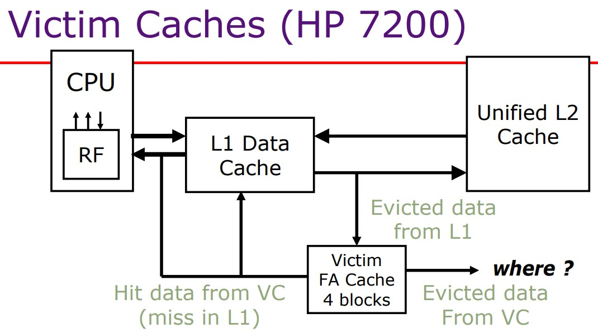

# Cache Programming Challenge 

## Overview
Implement a virtual cache with the provided parameters which can perform a series of memory reads within the given memory region. The memory region is provided within `memory.bin`. Each line of `reads.txt` specifies an offset into the memory region. The flag will be composed of the first byte of some of the virtual cache lines after all the reads are performed. 

## Instructions
### Reading the Memory Region
You have been provided the binary file, `memory.bin`. This file contains bytes which will serve as your memory region and should be loaded by your virtual cache. 

### Reading the Reads File
You have been provided the text file, `reads.txt`. Each line of this file specifies a one-byte read which will take place given as an offset into the memory region. An offset will not exceed the size that can be represented by an unsigned int. On a read, your virtual cache should load the cache line that contains the specified memory address. 

### Cache Basics
A cache is used to optimize memory accesses to memory storage hardware. The faster types of memory hardware is usually more expensive and larger for its storage capacity, so a tiered approach is used in modern processors to balance between storage capacity, price, and speed.

When you are given a memory address, you will calculate which cache line should contain the memory address by using the modulo operator, the number of cache lines, and the size of a cache line. For example, if I have a cache with `4` lines which each store `16` bytes and I try to access address `0x00002004`, I know that my memory will exist as the 4th byte on a cache line as `0x00002004 % 16 = 4`, and I know that the line in the cache in which I should look for my memory address should be line 0, as `0x00002004 / 16 = 0x0000200` (remove part being used for offset) then `0x0000200 % 4 = 0`. Now that we know what line to check, our last step is to confirm that this line is in fact the same memory address and not another that maps to the same line (so you'll need to store a line's address in your virtual cache). 

### Cache Prameters
Your virtual cache will model the cache used by the HP PA-7200 microprocessor released in 1995. This cache can be viewed as three distinct parts, the L1 Cache, the Victim Cache, and the L2 Cache. 

#### L1 Cache
The L1 cache will have `32` distinct cache lines, each `64` bytes long. This is the first place your program should look to try and perform memory reads from. If the L1 cache does not contain the needed memory address, it will first check the Victim cache and then check the L2 cache. Any time a line is evicted from this cache, it will be placed into the Victim cache.

#### Victim Cache
The Victim cache will have `8` distinct cache lines, each `64` bytes long. It will contain lines which have been recently evicted from the L1 cache. If the L1 cache lookup fails, you will check here for the desired memory address. If the desired memory address is present, you will add the cache line back into the L1 cache. If an L1 cache line is evicted, it will be placed in here, displacing whatever line was previously there.

#### L2 Cache 
The L2 cache will have `256` distinct cache lines, each `64` bytes long. When a line is neither in the L1 nor the Victim cache, you should look for it here. If the desired memory address is present, you will add the cache line back into the L1 cache. If the desired memory address is not present, you will pull it from the memory segment.

### Printing the Flag
The flag is generated by reading the first byte of the first 8 lines of the L1, Victim, and L2 cache and appending them together between the flag braces: "flag{[8 L1] + [8 Victim] + [8 L2]}".

## Scoring
As always when preparing your writeup, you will be evaluated based on the following software engineering pillars:

- Correctness (printing the flag)
- Safe from bugs (handles bad input without crashing)
- Easy to understand (commented and inuitive program structure)
- Ready for change (modular implementation)
- Adherence to the [Google C Style Guide](https://google.github.io/styleguide/cppguide.html).
